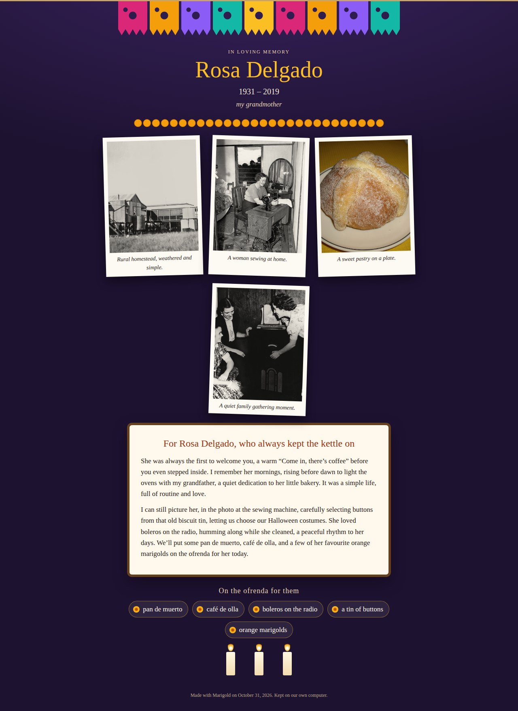
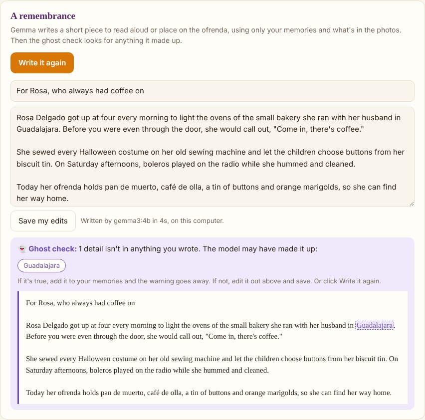
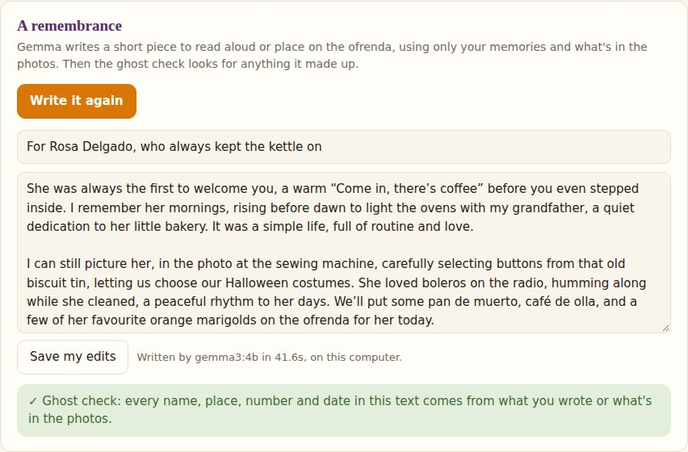

# Marigold 🌼

[](https://github.com/GurminderKaur/Marigold/actions/workflows/ci.yml)

**A private, offline ofrenda for the people you remember.**

Add a few old photos and write down what you remember: what they always said, what they cooked, the song they hummed. A local open-weight model (**Gemma 3 4B via Ollama**) looks at each photo and writes a short remembrance **using only what you gave it**. Marigold then builds an ofrenda page with their photos, your words and their favourite things, saved as **one HTML file** you can keep, print or share.



## The ghost check 👻

A language model writing about someone you loved will sometimes "remember" things that never happened: a town she never lived in, a year that's wrong, a name nobody had. In a remembrance, that's the worst kind of mistake.

So Marigold doesn't just ask the model to stick to the facts. It **checks**. Every name, place, number, month and weekday in the text is compared against everything you wrote and what the model saw in the photos. Anything that came from nowhere is flagged as a *ghost* and highlighted. Here's what a catch looks like (from a test where an invented city is planted on purpose):



And here's Gemma 3's real output in CI, built from the family's memories, with nothing invented:



If it's true, add it to your memories and the warning goes away. If it isn't, edit it out. The check is plain string matching, not another model guessing, so it's predictable and you can read exactly how it works in [`Ghosts.cs`](src/Marigold/Ghosts.cs).

## Private by design

- **Photos and memories never leave your computer.** The model runs locally through Ollama. The app is served on `127.0.0.1` only.
- **Photos are copied into Marigold's own folder** (`~/.marigold`), so the ofrenda keeps working if the originals move. Removing someone removes Marigold's copies only, never your originals.
- **The ofrenda is a single self-contained file:** photos embedded, no scripts, no links, no web fonts. It opens in any browser, prints to PDF, and doesn't need Marigold, or any service, to still exist in twenty years.
- The local server rejects requests for any host other than `127.0.0.1` (blocks DNS-rebinding) and needs a custom header for every change, so another website open in your browser can't read or edit anything.

## Set up on Windows (about 15 minutes, once)

**Easiest:** download `marigold-win-x64.zip` from [Releases](https://github.com/GurminderKaur/Marigold/releases), unzip it outside your Downloads folder, and double-click `marigold.exe`. (Windows SmartScreen may warn about an unsigned app: **More info → Run anyway**.)

You also need **Ollama** with the Gemma model:
```powershell
winget install -e --id Ollama.Ollama
ollama pull gemma3:4b        # ~3.3 GB, one time
```

**From source** (needs the .NET 8 SDK):
```powershell
git clone https://github.com/GurminderKaur/Marigold.git
cd Marigold\src\Marigold
dotnet run -c Release
```
Your browser opens at **http://127.0.0.1:5180**. Add a name, drop in photos, write what you remember, and click **Write a remembrance with Gemma**.

Remembrances can be written in English, Español, Français, Português, ਪੰਜਾਬੀ or हिन्दी. (The ghost check catches numbers in every language, but names only in languages with capital letters.)

## How it's tested

- **33 built-in self-tests** (`marigold selftest`) cover the ghost check (invented cities, years, weekdays, people; no false alarms on sentence starts, "May she rest", family words like *Abuela*), photo validation by file content, storage surviving a restart, and the ofrenda page (escaped text, embedded photos, no scripts or links). They run on Windows, macOS and Linux on every push.
- **The real model, in a real browser:** CI installs Ollama and `gemma3:4b`, downloads a few **public-domain photos** from Wikimedia Commons (licence checked, credits recorded), and a Playwright test uses the app like a person would: add someone, upload photos, wait for Gemma, write the remembrance, check the ghost check, open and download the ofrenda. The memories in [`samples/person.json`](samples/person.json) are fictional.

### Latest real-model run (`gemma3:4b`, CPU-only GitHub runner, no GPU)

| | Result |
|---|---|
| Photos described (4 public-domain archive photos) | 4 / 4, no names guessed |
| Era guesses vs. the archive's dates | sewing machine 1944 → "1930s–1950s" ✅, radio c. 1942 → "1950s" (close), homestead 1922 → "1930s–1950s" (a bit late) |
| Time per photo | ~67 s |
| Writing the remembrance | ~42 s, 115–135 words |
| Ghost check on the real output | **0 invented details** (browser run and command-line run) |

**What I changed because of the real model:** the remembrance was first requested as JSON; Gemma 3 4B twice ran to its length limit without closing the string. It's now plain text (title line, then the remembrance), and a cut-off answer is detected and retried. The first passing run also leaned on the photo descriptions instead of the memories, so the prompt now says to build it mainly from the family's memories and mention a photo at most once.

Sample photo credits: [`samples/photos/CREDITS.md`](samples/photos/CREDITS.md).

## Built with

[.NET 8](https://dotnet.microsoft.com) (ASP.NET Core minimal API) with **no third-party packages**, [Ollama](https://ollama.com), and [Gemma 3](https://ai.google.dev/gemma) (open weights, [Gemma Terms of Use](https://ai.google.dev/gemma/terms)). Swap the model with `--model`, e.g. `gemma3:12b` or `qwen2.5vl:7b`.

**Limits:** a 4B model on a laptop without a graphics card is slow (expect tens of seconds per photo). Gemma describes what's visible and may misjudge the era. It never names people, and you can change any caption.

## Licence

MIT. See [LICENSE](LICENSE).
